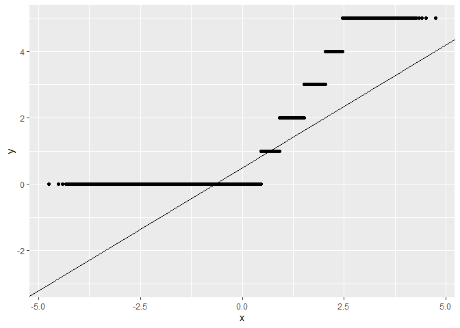
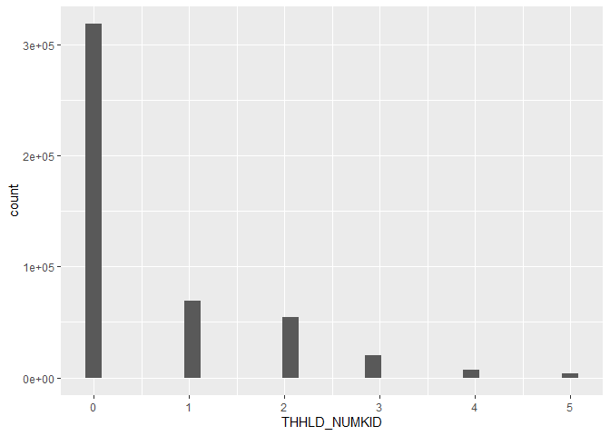

# Geog4/6300: Lab 4


- [<span class="toc-section-number">1</span> One and two sample
  difference tests](#one-and-two-sample-difference-tests)
- [<span class="toc-section-number">2</span> Assessment
  criteria](#assessment-criteria)
  - [<span class="toc-section-number">2.1</span> Loading/filtering data
    and checking for
    normality.](#loadingfiltering-data-and-checking-for-normality)
  - [<span class="toc-section-number">2.2</span> Testing the difference
    in number of
    children.](#testing-the-difference-in-number-of-children)
  - [<span class="toc-section-number">2.3</span> Identifying differences
    in time displaced by natural disasters across income
    groups](#identifying-differences-in-time-displaced-by-natural-disasters-across-income-groups)
  - [<span class="toc-section-number">2.4</span> Challenge
    Question:](#challenge-question)
  - [<span class="toc-section-number">2.5</span> Final submission
    stuff](#final-submission-stuff)

## One and two sample difference tests

**Overview:** In this lab, you’ll be doing analysis with public use
microdata from the Household Pulse survey administered by the U.S.
Census Bureau during the COVID pandemic. The survey had a particular
focus on pandemic effects on health and wellbeing, but it also included
questions on the impact of natural disasters on households. That’s the
section you’ll be focusing on here.

Unlike the aggregate census data you’re probably used to working with,
microdata provide anonymized individual-level responses that researchers
can use to calculate their own summary statistics and estimates.

There’s more info on the Pulse survey and the public use microdata file
at this link:

- [Household Pulse Survey Public Use
  Files](https://www.census.gov/programs-surveys/household-pulse-survey/data/datasets.html)

The main data are contained in the `pulse_2023` csv file in the data
folder. The data dictionary for this dataset is also available in the
data folder.

You’ll use this data to answer two research questions:

- Did households displaced by natural disasters include more children
  than those not displaced?
- Is there a relationship between household income and a household’s
  ability to return to its place of residence after being displaced?

## Assessment criteria

This lab assesses the following learning standards:

21. Assess the normality of a variable and use those results to select
    between parametric and non-parametric statistical tests.
22. Apply two-sample tests of difference and accurately interpret
    results in terms of hypothesis testing, statistical significance,
    and the direction and magnitude of any differences.
23. Construct contingency tables and apply chi-square tests to assess
    association between categorical variables, interpreting results in
    terms of significance and practical meaning.

### Loading/filtering data and checking for normality.

In the first part of the lab, you’ll be using two variables:
THHLD_NUMKID (number of children in a household) and ND_DISPLACE
(whether a household was displaced by a natural disaster in the last
year).

Load the dataset using read_csv, and also take a look at the two
variables of interest in the data dictionary. For this lab, you only
want observations with valid responses, filtering out records where
respondents did not provide an answer. Filter these data so you have
only valid responses.

**Task 1** *Load the Pulse data and filter it to only valid responses.*

``` r
Pulse_Data<-read_csv("data/pulse_2023.csv")
```

    Rows: 539305 Columns: 48
    ── Column specification ────────────────────────────────────────────────────────
    Delimiter: ","
    chr  (2): SCRAM, EST_ST
    dbl (46): WEEK, EST_MSA, REGION, HWEIGHT, PWEIGHT, TBIRTH_YEAR, ABIRTH_YEAR,...

    ℹ Use `spec()` to retrieve the full column specification for this data.
    ℹ Specify the column types or set `show_col_types = FALSE` to quiet this message.

``` r
Filtered_Pulse<-Pulse_Data%>%
  group_by(THHLD_NUMKID, ND_DISPLACE)%>%
  filter(!is.na(THHLD_NUMKID), !is.na(ND_DISPLACE))

Questionable_Filter<-Pulse_Data%>%
  filter(THHLD_NUMKID>=0, ND_DISPLACE>=0)
```

You’ll be conducting a two-sample test of difference to look at whether
the number of children differs between those displaced and not
displaced. To know which test to use, you have to assess the normality
of the THHLD_NUMKID variable.

**Task 2** *Assess the normality of this variable using either a
histogram OR a qq line. Make sure your plot is visible and interpret
what it shows you about the normality of this variable.*

``` r
ggplot(Questionable_Filter,aes(sample=THHLD_NUMKID))+
  stat_qq()+
  stat_qq_line()
```



``` r
ggplot(Questionable_Filter,aes(x=THHLD_NUMKID)) + 
  geom_histogram()
```

    `stat_bin()` using `bins = 30`. Pick better value `binwidth`.



``` r
#I find the histogram easier to interpret and does not look as "off" (I know I did not need both but its not hard to follow). The histogram shows a clear right scew to the data. A normal distribution of the histogram would have a bell shape. This is concentrated around lower values. 
```

### Testing the difference in number of children.

Now you can test whether the number of children differs between
displaced and non-displaced households.

**Task 3** *Based on the normality of the data, what is the appropriate
statistical test for determining whether the number of children differs
between these two groups? Explain why this test is appropriate and give
a null and alternative hypothesis for this test*

{A wilcoxin test should work because it would work as a two-pair if the
data were noramlly distributed. This is right scewed, so it is
non-parametric and needs its null hypothesis disproved.

Null:Displaced and non-displaced people have no difference in number of
children Alternative:Displaced and non-displaced people have a
difference in number of children.}

**Task 4** *Run the test you identified in Task 3. Also calculate the
mean for each dataset, which you can use to determine the nature of the
difference–which group (if any) has more children.*

``` r
 Displacement<-Questionable_Filter%>%
  select("ND_DISPLACE")

 Children<-Questionable_Filter%>%
   select("THHLD_NUMKID")
   


wilcox.test(Displacement$ND_DISPLACE, Children$THHLD_NUMKID, paired=TRUE)
```

        Wilcoxon signed rank test with continuity correction

    data:  Displacement$ND_DISPLACE and Children$THHLD_NUMKID
    V = 8.2993e+10, p-value < 2.2e-16
    alternative hypothesis: true location shift is not equal to 0

``` r
#data:  Displacement$ND_DISPLACE and Children$THHLD_NUMKID
#W =8.2993e+10, p-value < 2.2e-16
#alternative hypothesis: true location shift is not equal to 0

Mean_values<-Questionable_Filter%>%
  group_by(`ND_DISPLACE`)%>%
  summarise(NumKids_mean=mean(THHLD_NUMKID))
```

**Task 5** *Interpret the results of the analysis you did in task 4.* \*
Do you reject the null hypothesis? Why or why not?

The null hypothesis should be rejected because the p-value of the
Wilcoxin test is \<0.05 (p-value \< 2.2e-16). This shows that there is a
correlation between number of children and displacement.

- Based on the test result and the group means, what can we conclude
  about differences in the number of children between these two groups?

People who were displaced are more likely to have more children. The
mean of the displaced was around 0.75 while the non-displaced was around
0.60. People with more children are more likely to be displaced.

### Identifying differences in time displaced by natural disasters across income groups

In Part 2, you used a test of difference that included a continuous and
categorical variable. In this section, you’ll focus only on households
displaced by natural disasters to identify statistically significant
differences in time displaced using two categorical variables: one
placing responses into groups by income (INCOME) and the other showing
the time displaced (ND_HOWLONG).

Again, look at the data dictionary to better understand how these two
variables are structured.

**Task 6** *Reload the original, unfiltered Pulse dataset (not the one
you used in parts 1 and 2). Select only observations for households
displaced by a natural disaster using the ND_DISPLACE variable. Then
filter for records with valid responses to INCOME and ND_HOWLONG. Call
the head of the table with `kable` when done.*

``` r
Income_Comparison<-Pulse_Data%>%
  select(ND_DISPLACE,INCOME,ND_HOWLONG)%>%
filter(ND_DISPLACE==1, INCOME>=0, ND_HOWLONG>=0)

kable(head(Income_Comparison))
```

| ND_DISPLACE | INCOME | ND_HOWLONG |
|------------:|-------:|-----------:|
|           1 |      3 |          1 |
|           1 |      4 |          1 |
|           1 |      4 |          5 |
|           1 |      6 |          1 |
|           1 |      8 |          1 |
|           1 |      1 |          5 |

**Task 7** *Create a contingency table of responses to the ND_HOWLONG
variable by INCOME. The rows of this table should be the income groups
and the columns should be the categorical variables showing time
displaced. Call the table when you are done.*

``` r
Contingency_Income<-Income_Comparison%>%
   count(ND_HOWLONG,INCOME,name="count")%>% 
  pivot_wider(names_from=ND_HOWLONG,names_prefix="ND_HOWLONG_",values_from=count,values_fill=0) #Asked Chatgpt for a Column                                                                                                   name function.

  
kable(Contingency_Income)
```

| INCOME | ND_HOWLONG_1 | ND_HOWLONG_2 | ND_HOWLONG_3 | ND_HOWLONG_4 | ND_HOWLONG_5 |
|-------:|-------------:|-------------:|-------------:|-------------:|-------------:|
|      1 |          286 |          218 |          115 |           69 |          179 |
|      2 |          162 |          122 |           50 |           23 |           63 |
|      3 |          221 |          135 |           67 |           32 |           50 |
|      4 |          316 |          160 |           78 |           42 |           52 |
|      5 |          219 |          107 |           54 |           23 |           33 |
|      6 |          317 |          115 |           58 |           37 |           37 |
|      7 |          142 |           54 |           22 |            8 |           11 |
|      8 |          223 |           64 |           45 |           35 |           43 |

**Task 8** *Run a chi-square test on your contingency table to assess
whether there are statistically significant differences in displacement
time between these income groups. You’ll likely need to delete the
INCOME variable to do so.*

``` r
Incomeless_table<-Contingency_Income%>%
  select(ND_HOWLONG_1:ND_HOWLONG_5)


chisq.test(Incomeless_table)
```

        Pearson's Chi-squared test

    data:  Incomeless_table
    X-squared = 210.51, df = 28, p-value < 2.2e-16

``` r
#Pearson's Chi-squared test

#data:  Incomeless_table
#X-squared = 210.51, df = 28, p-value < 2.2e-16
```

**Task 9** *To help with your interpretation of results, Calculate the
percentage of households within each income group that fall into
category 1 of ND_HOWLONG (“displaced less than a week”).*

``` r
Income_Percentage<-Contingency_Income%>%
  pivot_longer(`ND_HOWLONG_1`:`ND_HOWLONG_5`,names_to="ND_HOWLONG",values_to="count")%>% 
  group_by(INCOME)%>%
  mutate(total=sum(count))%>%
  mutate(pct=round(count/total*100,1))%>% #A bit more than just category 1 but it does not hurt. It looked odd with just ND1
  select(-count)%>% 
  pivot_wider(names_from=ND_HOWLONG,values_from=pct) 

kable(Income_Percentage)
```

| INCOME | total | ND_HOWLONG_1 | ND_HOWLONG_2 | ND_HOWLONG_3 | ND_HOWLONG_4 | ND_HOWLONG_5 |
|-------:|------:|-------------:|-------------:|-------------:|-------------:|-------------:|
|      1 |   867 |         33.0 |         25.1 |         13.3 |          8.0 |         20.6 |
|      2 |   420 |         38.6 |         29.0 |         11.9 |          5.5 |         15.0 |
|      3 |   505 |         43.8 |         26.7 |         13.3 |          6.3 |          9.9 |
|      4 |   648 |         48.8 |         24.7 |         12.0 |          6.5 |          8.0 |
|      5 |   436 |         50.2 |         24.5 |         12.4 |          5.3 |          7.6 |
|      6 |   564 |         56.2 |         20.4 |         10.3 |          6.6 |          6.6 |
|      7 |   237 |         59.9 |         22.8 |          9.3 |          3.4 |          4.6 |
|      8 |   410 |         54.4 |         15.6 |         11.0 |          8.5 |         10.5 |

**Task 10** *Interpret the results of your analysis in tasks 8 and 9.*
\* Do you reject the null hypothesis based on these results and why (or
why not)?

I would reject the null that income does not effect length of
displacement. The x^2 value is larger than the critical value and the
p-value from the chi-squared test shows there is a significant
difference. Income does effect how long a family is displaced.

- What do your results in Task 9 tell you about differences in how
  quickly households were able to return?

Higher incomes generally could return quicker in category 1 of
displacement and consistently increased in percentage returned until
level 8. I believe the discrepancy in level 8 comes from people in this
income bracket completely moving away more frequently. They have the
resources to move and it shows based on the level 5 displacement
percentages. The highest incomes moved away entirely more frequently
than the previous 5 income levels.

### Challenge Question:

Calculate and map the percentage of households reporting displacement
(ND_DISPLACE) by state. To do so, you’ll need to start with a version of
the dataset that excludes non-valid responses and then calculate the
percentage displaced by state.

Once you’ve calculated that estimate, map it out using the
`states_albers` geopackage file in the data folder. Provide a brief
description of the patterns you observe.

``` r
#Code goes here
```

### Final submission stuff

**Disclosure of assistance:** Besides class materials, what other
sources of assistance did you use while completing this lab? These can
include input from classmates, relevant material identified through web
searches (e.g., Stack Overflow), or assistance from ChatGPT or other AI
tools. How did these sources support your own learning in completing
this lab?

{I really only used ChatGPT for the column naming function. I asked what
the x^2 meant in a chi-squared test. I now know it is ascosiated with a
critical value from the chi-squared table. my results would have been
above the critical value up to and past 99%. I asked if the negative
values were associated with NA, but I got further clarification in
class. Like you have said, this lab is hard because of statistical
analysis not coding.}

**Lab reflection:** How do you feel about the work you did on this lab?
Was it easy, moderate, or hard? What are the biggest things you learned
by completing it?

{I think this was the easiest lab so far. I put notes into the script
where I thought they could be used later. This made knowing how to
approach the code alot easier. I am mainly worried about my analysis.
Task 9 is also a bit beyond but just doing ND_LONG_1 does not work. It
moves the column to the end and row is put at 100%. I adapted it from
script 18, so I am missing how the function works somewhere. I applied
what we learned about normality, p-values, and hypothesis in class to
this lab. I know what the different scews and p values indicate now.
Finally, I know how to use the chi-squared tables and critical values to
see if x is above the cutoff.}
